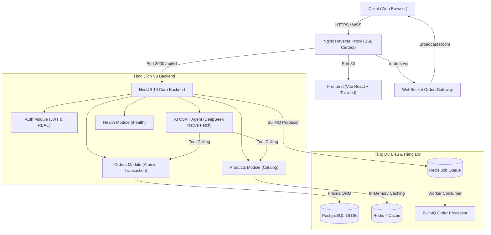

# 🚀 ShopFast — Sàn Thương Mại Điện Tử Công Nghệ Thế Hệ Mới
**Defense Case Study 6 — Rikkei Academy (Module 6)**

[](https://github.com/chinhan142/ShopFast/actions/workflows/ci-cd.yml)
[](https://nodejs.org/)
[](https://nestjs.com/)
[](https://www.postgresql.org/)
[](https://redis.io/)
[](https://deepseek.com/)

---

## 📌 1. Giới thiệu Dự án
ShopFast là hệ thống thương mại điện tử phục vụ quy mô ~200.000 khách hàng, tập trung vào các mặt hàng thiết bị công nghệ cao cấp. Dự án được thiết kế chuẩn **Clean Architecture / Modularity**, tích hợp 5 năng lực công nghệ nâng cao của Module 6:
* **F01 (AI Agent CSKH):** Tích hợp DeepSeek qua **Tool Calling** tra cứu đơn hàng & tồn kho thực tế, Anti-Hallucination và Human-in-the-loop.
* **F02 (Realtime):** WebSocket Gateway (`Socket.io`) theo dõi trạng thái đơn hàng theo Room bảo mật, cập nhật tức thì khi kho thay đổi.
* **F03 (Rate Limiting & Security):** Throttling toàn bộ API, chặn leo thang brute-force dò mật khẩu theo tài khoản mục tiêu.
* **F04 (Caching):** Redis In-Memory Cache cho catalog và chi tiết sản phẩm ($\le 20\text{ ms}$), cơ chế Invalidation khi cập nhật giá/kho, graceful degradation khi Redis gặp sự cố.
* **F05 (Background Jobs):** BullMQ Queue gửi email xác nhận (Idempotent), xuất hóa đơn và hẹn giờ nhắc thanh toán sau 30 phút. Tích hợp UI giám sát **Bull-Board**.
* **F06 (Nghiệp vụ cốt lõi):** Quản lý sản phẩm, tồn kho và giỏ hàng; đặt hàng bằng **Database Transaction** khóa nguyên tử chống oversell.
* **F07 (Vận hành & Giám sát):** Health Check endpoint `/api/v1/health`, Swagger OpenAPI docs `/api/docs`, script sao lưu và diễn tập khôi phục DB.

---

## 🏗️ 2. Sơ đồ Kiến trúc Hệ thống



---

## 🛠️ 3. Hướng dẫn Chạy Cục bộ (Local Development)

### Cách 1: Chạy toàn bộ bằng Docker Compose (Khuyên dùng - 1 lệnh duy nhất)
```bash
docker compose up -d --build
```
Hệ thống sẽ tự động khởi động:
* **Frontend:** `http://localhost`
* **Backend API & Swagger:** `http://localhost:3000/api/docs`
* **Bull-Board Dashboard:** `http://localhost:3000/admin/queues`
* **Health Check:** `http://localhost:3000/api/v1/health`

### Cách 2: Chạy thủ công từng thành phần
1. **Khởi chạy PostgreSQL & Redis:**
   ```bash
   docker compose up -d postgres redis
   ```
2. **Khởi chạy Backend:**
   ```bash
   cd backend
   npm install
   npx prisma generate
   npx prisma migrate dev
   npm run prisma:seed    # Nạp tài khoản và sản phẩm mẫu
   npm run start:dev
   ```
3. **Khởi chạy Frontend:**
   ```bash
   cd frontend
   npm install
   npm run dev
   ```

---

## 🔑 4. Tài khoản Demo có sẵn (Seed Data)
| Vai trò (Role) | Email | Mật khẩu | Mục đích Demo |
| :--- | :--- | :--- | :--- |
| **Quản Trị Viên (Admin)** | `admin@shopfast.vn` | `Admin@123456` | Toàn quyền hệ thống, xem Swagger & Bull-board |
| **Nhân Viên Kho (Staff)** | `warehouse@shopfast.vn` | `Staff@123456` | Cổng kho vận, bấm đổi trạng thái đơn kích hoạt Realtime |
| **Khách Hàng (Customer)** | `customer@shopfast.vn` | `Customer@123456` | Mua hàng, xem theo dõi đơn realtime, chat AI CSKH |

* **Mã đơn hàng mẫu sẵn sàng test:** `SF-DEMO-001`

---

## 🧪 5. Kiểm thử Tự động (Unit Tests & Coverage)
Hệ thống có **5 bộ Test Suites** với **28 ca kiểm thử đơn vị** đạt độ phủ tầng nghiệp vụ $\ge 60\%$:
```bash
cd backend
npm test          # Chạy toàn bộ 28 unit tests
npm run test:cov  # Kiểm tra bảng độ phủ dòng lệnh
```

---

## 🔄 6. Cơ chế Tự Động Quay Lui (Rollback) & Sao Lưu DB
1. **CI/CD Rollback:** Script triển khai trong `.github/workflows/ci-cd.yml` sau khi `docker compose up` sẽ gọi `curl` kiểm tra `/api/v1/health` 12 lần (trong vòng 60 giây). Nếu không trả về HTTP 200 OK $\to$ Tự động checkout lại commit ổn định trước đó và redeploy lại trong dưới 2 phút.
2. **Sao lưu Database tự động:**
   ```bash
   chmod +x scripts/backup-db.sh
   ./scripts/backup-db.sh
   ```
3. **Diễn tập khôi phục Database:**
   ```bash
   chmod +x scripts/restore-db.sh
   ./scripts/restore-db.sh /var/backups/shopfast/shopfast_db_YYYYMMDD_HHMMSS.sql.gz
   ```
